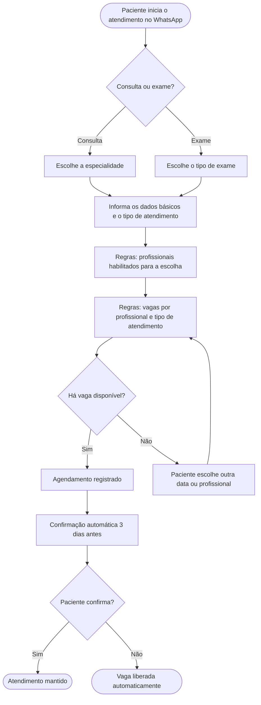

# Autoagendamento via WhatsApp: do levantamento de requisitos à homologação

Estudo de caso de um projeto de autoagendamento e confirmação automática de consultas e exames em um hospital-dia, com foco em engenharia de requisitos, mapeamento de processos e homologação.

| | |
|---|---|
| **Meu papel** | Analista de TI e Sistemas, responsável pelo levantamento de requisitos, mapeamento de processos e acompanhamento da homologação |
| **Ferramentas** | Miro, ERP hospitalar (SisH2005), Droyds Omni (WhatsApp Business API), SQL (extração de relatórios), planilhas |
| **Competências** | Engenharia de requisitos, modelagem de processos, configuração de fluxos de chatbot, homologação (QA), gestão de mudança |

> Nota: nomes de profissionais, convênios, valores e regras específicas foram omitidos ou generalizados neste material.

## 1. O desafio

O atendimento por WhatsApp do hospital era manual. A fila de conversas aguardando resposta ficava, em média, com **6 páginas**, e chegava a **12 páginas (cerca de 300 pacientes, 25 por página)** nos picos, no meio da semana. Os pacientes esperavam muito para marcar consultas e exames, e havia faltas por falta de confirmação prévia.

O projeto de autoagendamento já existia, mas estava parado. As regras de negócio eram complexas: exames liberados por profissional, número de agendamentos por médico, vagas por convênio, valores, e agendas no sistema com horários diferentes dos informados ao paciente.

## 2. O que eu fiz

- **Corrigi a base de agendas:** ajustei no sistema as agendas que estavam com horários divergentes do que era informado ao paciente.
- **Levantei os requisitos:** reuni planilhas dispersas com informações soltas (cerca de metade dos dados vinha delas) e extraí do sistema um relatório de 5 anos de exames executados por profissional. Apliquei filtro de duplicados para chegar à relação final de exames por médico.
- **Validei com quem usa o processo:** apresentei as regras à gerência e conversei com os atendentes do agendamento para entender as demandas reais.
- **Mapeei as regras no Miro:** desenhei os fluxos de decisão por especialidade, exame, médico e convênio.
- **Configurei o fluxo de atendimento:** montei o fluxo do WhatsApp (API do Meta) usando a ferramenta de blocos conectáveis do fornecedor.
- **Preparei a homologação:** solicitei à equipe de infraestrutura um servidor de teste separado da produção, acompanhei a instalação do sistema nele pela equipe do ERP, com backup, e os testes foram feitos pela equipe do fornecedor antes de qualquer uso real.
- **Implantei a confirmação automática:** o paciente recebe a mensagem 3 dias antes (data, hora e local). A resposta é salva no sistema e, se ele recusar, a vaga é liberada automaticamente.

Fluxo simplificado e ilustrativo, sem nenhum dado real do hospital:

## 3. Resultados

| Indicador | Antes | Depois |
|---|---|---|
| Fila no WhatsApp (média) | cerca de 6 páginas | ver nota abaixo |
| Fila no WhatsApp (pico) | 12 páginas (cerca de 300 pacientes) | cerca de 5 pacientes (redução de cerca de 98%) |
| Confirmação de consultas | manual | automática, 3 dias antes |
| Liberação de vagas por cancelamento | manual | automática |

Nota: o impacto da confirmação automática nas faltas ainda não foi medido neste material. [Se você tiver o número, coloque aqui.]

## 4. Aprendizados

- O mapeamento do processo de negócio pesou mais do que qualquer ferramenta: sem regras claras, o fluxo não funciona.
- Dados espalhados em planilhas precisam ser consolidados e validados com quem trabalha com eles antes de virarem regra.
- Um ambiente de homologação separado da produção reduz o risco de testar em um hospital em funcionamento.
- Treinar quem opera o fluxo é tão importante quanto configurá-lo.

## 5. Próximos passos que eu faria

- Medir a taxa de faltas antes e depois da confirmação automática.
- Documentar as regras de negócio em um formato versionado, fácil de atualizar quando as agendas mudarem.
